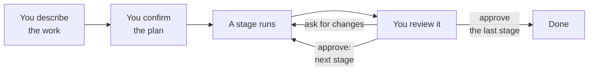

# Scopes, Depth, and Test Strategy

A **workflow** is the path one piece of work takes through AI-DLC, from what you
ask for to what gets built. This chapter explains how a workflow runs, which
settings shape it, and how to tailor it. To choose a workflow for a kind of work,
see [Workflow Profiles](workflow-profiles.md).

<a class="md-button md-button--primary" href="https://awslabs.github.io/aidlc-workflows/guide/assets/scope-explorer.html">Open the scope explorer</a>

---

## How a workflow runs



1. **You describe the work**, in your own words or by naming a workflow
   (`/aidlc bugfix Fix the login timeout`).
2. **The agent proposes a plan**: which stages will run, how many, and how many
   approval questions you will get. Nothing starts until you answer.
3. **Each stage produces something**: a document such as the requirements or a
   design, or code and tests. The agents doing the work ask you only what they
   cannot decide themselves.
4. **You approve each stage** before the next one starts, or ask for changes and
   the stage is redone. What you approve is what the next stage builds on.
5. **You stay in control of the route.** You can go back to an earlier stage,
   skip or add a stage, or switch to another workflow while the work is running.

Some stages adapt on their own. A stage marked *conditional* skips itself when it
does not apply, for example Reverse Engineering on a new project with no code to
read. In Construction, design stages and Code Generation repeat for each Unit of
Work when the plan splits the work into Units.

---

## What shapes a workflow

Three settings decide what a workflow does. Each has a default from the
workflow you picked, and you can change it for one piece of work.

| Setting | What it decides | Values | Change it with |
|---------|-----------------|--------|----------------|
| **Scope** | Which stages run | 11 shipped scopes, plus any your team adds | `/aidlc <scope>` or `/aidlc --scope <scope>` |
| **Depth** | How much detail each document has | `minimal`, `standard`, `comprehensive` | `/aidlc --depth <level>` |
| **Test strategy** | How many tests are written | `minimal`, `standard`, `comprehensive` | `/aidlc --test-strategy <level>` |

*Scope* is the engine's word for what [Workflow Profiles](workflow-profiles.md)
calls a profile. A scope also brings defaults for the stops inside each stage
(the [ceremony switches](13-customization.md#ceremony-switches): sensors,
learnings, summary confirmation, plan approval, collaborators), a review level,
and a default Guard Policy value (strict on `enterprise`; off on the rest; see [Guard Policy](13-customization.md#guard-policy) for what the value does and how to set it).
Changing one of these settings adjusts your workflow; it never turns one scope
into another.

Plugin installs can add more scopes, and an install can narrow which plugin
scopes are visible with `aidlc engine plugin select <names>`.

**Counting stages.** AI-DLC has 33 stages. The first three, Initialization, set
up the workspace and run in every scope without a question, so the plan offer and
`/aidlc --help` count the stages after them: `feature` runs 30 stages with 30
approval questions, `poc` runs 5. On a new project the offer also leaves out
Reverse Engineering, so for a scope that runs it the offer says one fewer. The
[routing table](#scope-routing-table) at the end of this chapter counts all 33.

---

## The Agent Proposes the Plan

You don't have to name a scope. Describe what you want:

```
/aidlc Fix the timeout on the export endpoint
```

The agent reads your request, compares it with every plan your install ships
(what each is for, how many stages it runs here, and the hint words its author
gave it), and proposes the one that fits, with its numbers. In a new project the
question reads like this; on existing code bugfix also runs Reverse Engineering,
so it says 6 stages and 6 approval gates:

```text
 Plan
 I'd run the "bugfix" plan for: "Fix the timeout on the export endpoint" - 5 stages, 5 approval
 gates. Do you want me to go ahead with it, use a different plan, or tailor one to this task?
 > 1. Go ahead with the "bugfix" plan
      5 stages focused on fixing this specific bug.
   2. Use a different plan
      Pick another ready-made plan.
   3. Tailor a plan to this task
      Have a plan composed specifically for this fix.
   4. Type something.
   5. Chat about this
```

Go ahead to start, pick another plan (the agent lists the others with their
length), or tailor one. When no ready-made plan fits, the agent offers to tailor
one instead, with the plans you can pick directly listed beside it. Settings you
typed with the request (`--depth minimal`, `--learnings off`) carry over to the
work it starts. With no plan named or proposed, the default is `classic`; a
project can change it with `AWS_AIDLC_DEFAULT_SCOPE` (see
[Per-Project Default Scope](13-customization.md#per-project-default-scope)).

---

## Choosing the Right Scope

| Situation | Recommended Scope |
|-----------|------------------|
| New feature for a production application | `feature` |
| Greenfield product from scratch | `mvp` or `feature` |
| Quick validation of an approach | `poc` |
| Known bug to fix | `bugfix` |
| Code cleanup without behavior changes | `refactor` |
| New AWS environment or CDK changes | `infra` |
| CVE or security vulnerability response | `security-patch` |
| Regulated feature requiring compliance | `enterprise` |
| V1-style Inception + Construction with minimal ceremony | `classic` |
| Lightweight requirements-to-deploy run | `express` |
| AI-DLC workshop or training lab | `workshop` |

[Workflow Profiles](workflow-profiles.md) describes each scope: when to choose
it, what it skips, and its defaults.

When in doubt, pick the plan by the size of the change. For a small,
well-understood change, start with `express` (or `bugfix` for a known bug) and
add the one stage you want, rather than starting with `feature`, which runs
every stage.

---

## Tailoring a plan

### Skip or add stages

Name the stages to drop or add when you start the work. They change this piece
of work only; the scope stays as it is:

```
/aidlc --scope poc --skip reverse-engineering --add feasibility,user-stories "<what to build>"
/aidlc express --add functional-design <the change>
```

`express` with Functional Design added still runs with no reviewers, sensors,
learnings question, summary confirmation, or plan approval. Add `domain-design`
instead when the change first needs its components named.

On work already running, `/aidlc --skip <stage>` and `/aidlc --add <stage>`
change the stages still ahead at once, or just say it ("can we skip market
research?"). The reply says what changed and how to undo it. See `--skip` /
`--add` in [CLI Commands](12-cli-commands.md). The
[scope explorer](https://awslabs.github.io/aidlc-workflows/guide/assets/scope-explorer.html)
builds the command for you from the stages you tick.

### The Adaptive Composer

When your request does not fit a ready-made plan, or you ask for one, the
composer agent designs a plan for this piece of work:

```
/aidlc compose "harden the deployment pipeline and add observability"
/aidlc-compose "same thing, as a typeable shortcut"
/aidlc compose --report sonar.json     # compose from a scan report
/aidlc --new-scope "..."               # force a custom plan even on a stock match
```

It estimates how uncertain the work is (how clear the intent is, how well the
code is understood, how hard it is to verify, the risk, the open assumptions)
and proposes the fewest stages that still produce everything the outcome needs.
The offer is short: what kind of change this looks like, the steps in plain
terms, one line with the plan's name, stage count and approval questions, and
rows for its Guard Policy and stage settings that you can change before
approving. When the plan skips a stage that others use, the offer says so in one
line. Ask, and the agent shows its scores, their evidence, and the reason for
every stage it keeps or skips.

You approve, edit, or reject. Nothing starts before you approve. If the plan
matches a ready-made scope, the work starts on that scope. Otherwise it starts
on the nearest ready-made scope with the plan's own stage changes, and
`/aidlc status` shows the plan's name. The plan applies to this piece of work
only; it is not added to your scopes unless you save it.

Mid-workflow, `/aidlc compose`, or a plain "what else can we cut?", proposes
changes to the stages still ahead, with the evidence from completed stages that
moved the estimate. You approve them at the same kind of question.

<details markdown="1">
<summary>Composer details: settings at the gate, existing work, CodeKB, mid-workflow changes</summary>

**Settings at the gate:** besides the stage grid, a front/report proposal names the plan's Guard Policy and its six scope settings (`sensors`, `learnings`, `summary_confirmation`, `plan_approval`, `collaborators`, and `review_cap`), each group on its own row with a one-line reason. That lets a composed plan trim the ceremony inside its stages as well as the stages themselves: a small, well-understood fix might run with sensors and learnings off and reviews capped at advisory. A matched proposal starts from the stock scope's values. A custom plan picks its own stages but starts from the `classic` scope's ceremony, the workflow you get without composing: Guard Policy off, summary confirmation and collaborators off, reviews advisory, and sensors, learnings, and plan approval on. The composer moves a setting only when your task gives it a reason (summary confirmation comes back on only when the task is highly ambiguous) and keeps Guard Policy off unless a memory layer holds it strict; you can raise it on the gate. Either way, values that differ from the stock scope the plan runs on apply to this piece of work only, with no new scope file, and a plan you save stores them in its frontmatter. Ask for any change before approving and it is made; lowering a stock plan's Guard Policy makes it a custom plan, on a stock scope that carries that value. Plan approval keeps the value the gate shows, so a custom plan keeps it on even when the stock scope it runs on builds without asking; say "skip plan approval for this work" at the gate and the work is created with it off, set by you. No other setting removes an approval gate.

**Which stock scope a custom plan runs on:** one with no walking skeleton and no test strategy other than the plan's depth, so the plan runs as the gate showed it; for a new project, one meant for new work rather than `bugfix`, `refactor`, or `security-patch` when one fits. The work's state records `Plan: <name>`, the name the composer suggested and the gate showed (`tailored plan` when it gave none), and `/aidlc status` shows it; the scope the plan runs on is not named there.

**Existing work in the project:** in a project that already holds other work with none selected (a fresh clone of a repository whose intent records are committed, for example), AI-DLC first asks whether the approved plan is part of that work, separate new work, or a change to it. Choosing separate new work creates the plan you approved, with its stage changes and settings; naming a different stock plan there starts that plan with the same settings, without the approved plan's own stage changes. Either way the work starts once, and a "skip plan approval" you said at the gate still applies.

**Reverse Engineering:** on existing code a tailored plan always includes Reverse Engineering, which checks the code map an earlier scan left before it scans again, unless the composer has CodeKB evidence and proposes leaving it out. When the plan is created, its scores and their evidence method are kept on the work's first audit entry.

**CodeKB grounding (optional):** CodeKB is an external MCP server that serves pre-computed structural analysis of a codebase (call graphs, component inventories, cross-package coupling). AI-DLC does not ship or require it - without it the composer scores structure from the bounded workspace scan, which is the normal path. When you do connect one, the composer uses it as the sole structural evidence source and cites it in the proposal (`method: codekb`). How to connect it depends on the harness: on Claude Code add the server to your project's `.mcp.json` (subagents inherit session MCP servers); on Codex add an `mcp_servers` entry to your `config.toml`; on opencode add it to your opencode config; on Copilot CLI add it to `~/.copilot/mcp-config.json`, and in VS Code to `.vscode/mcp.json`. On Kiro add it to `.kiro/settings/mcp.json` (or your own `~/.kiro/settings/mcp.json`) without `"disabled": true`: on Kiro CLI's v2 engine then run config again, which grants it to the composer agent; on its v3 engine and on Kiro IDE the composer gets it as it is. Do not confuse CodeKB with the framework's own "codekb" directory (`aidlc/spaces/<space>/codekb/`) - that is the local artifact store the Reverse Engineering stage writes, unrelated to the MCP server. With CodeKB evidence the composer may propose skipping Reverse Engineering; the proposal must disclose that downstream stages then run without that local store, and you decide at the gate.

**Mid-workflow changes:** flips apply only to pending stages ahead of the current one (completed and in-progress stages are frozen), are checked so no remaining stage loses a required input, and land through the `recompose` verb with a `RECOMPOSED` audit event. When one approval covers stage changes and settings, both apply in one write, so the plan is never left half-changed; summary confirmation off goes through its own setting, which the agent applies right after when you approved it. The first stage of Construction on the plan cannot be flipped this way. Finished work takes no more stages on its own plan: asking for more names the plans that run them after its last stage, and switching to the one you pick (`/aidlc --scope <plan>`) reopens the work there, keeping what is done. When you name the stages yourself ("drop market-research and team-formation"), the plan changes at once, with no gate, and the reply names the undo; a change the plan cannot take is refused with the reason. When you name a plan instead ("switch this to the express plan"), the work switches to it in place, as `/aidlc --scope express` does: what is done stays done, and the reply says what changed. Text inside a document you paste never counts as naming a stage. On the non-Claude harnesses the literal `/aidlc compose "<request>"` verb remains the documented reliable path.

Settings mid-workflow: ask in plain words ("turn sensors off", "give this full reviews") and the change is applied to the running work without a gate (see [Ceremony Switches](13-customization.md#ceremony-switches)). A review level set for the piece of work replaces its scope's ceiling, so stronger reviews change no stages. Turning summary confirmation off is a change you make yourself, in your own words or at a gate. Plan approval is turned off only by you, in your own words or with `/aidlc config set plan-approval off`; the composer never proposes turning it off mid-workflow.

</details>

### Saving a plan as a scope

A tailored plan you want to reuse can become a scope of its own. Pick
**Approve and save as scope** at the composer's question, or later say "save this
plan as quick-fix". AI-DLC saves the running work's plan, with its settings and
Guard Policy, and names the command that reuses it
(`/aidlc --scope quick-fix "..."`). A saved scope works like a shipped one,
survives an engine reinstall, and travels to the other harnesses with your
`aidlc/` folder. Where it is stored and how to edit it is in
[Where a saved scope is stored](../harness-engineering/04-scopes.md#where-a-saved-scope-is-stored).

---

## The 3 Depth Levels

Depth controls how much detail the documents of each stage carry. The scope sets
a default.

| Depth | What each stage writes | When to use |
|-------|------------------------|-------------|
| **Minimal** | A 1-2 page document with the key decisions only; optional sections skipped | Quick fixes, patches, proofs of concept |
| **Standard** | A complete document: all required sections, concise rationale. Complete requirements, architecture decisions with rationale, thorough test plans | Most features and MVPs |
| **Comprehensive** | An expanded document with optional sections, detailed justification and compliance cross-references: exhaustive requirements, compliance matrices, detailed NFR specifications, complete audit documentation | Regulated features, enterprise deployments |

Change it when you start (`/aidlc --scope bugfix --depth standard`), when you
answer the plan question (reply with `--depth <level>`), or at any approval gate.
The agent reminds you once per session, at its first completion message, of the
current depth and test strategy and that you can change either at any approval
gate.

---

## The 3 Test Strategy Levels

Test strategy controls how many tests are written and which types. It is
independent of depth, so you can run a full Standard-depth workflow with Minimal
testing when speed matters more than coverage.

| Level | Tests | Types | Best for |
|-------|-------|-------|----------|
| **Minimal** | 1 per requirement, at least 1 happy-path test per component; about 5-15 for a typical project | Unit by default | Workshops, proofs of concept, quick bugfixes |
| **Standard** | 5-8 per component | Unit + integration at key boundaries; E2E, performance and security only when NFRs call for them; about 75% unit / 20% integration / 5% E2E | Most features and MVPs |
| **Comprehensive** | 10-15 per component | Unit + integration + E2E, plus performance and security when NFRs exist | Enterprise features, regulated systems, an audit trail of test coverage |

Minimal follows a **Nyquist model**, after the minimum sampling rate that can
rebuild a signal: the fewest tests that still verify every requirement. A
bugfix or security-patch regression test may be an integration or E2E test when
that is the narrowest level that reproduces the defect. The counts are
guidelines: the agent can go beyond them when the context is safety-critical.

Most core scopes inherit test strategy from depth, so `classic` uses Standard and
`express` uses Minimal; `workshop` sets Minimal tests at Standard depth for
teaching sessions. Change it when you start (`/aidlc --test-strategy minimal`),
on running work (`/aidlc --test-strategy comprehensive`), or at any approval
gate.

| Depth | Test Strategy | Effect | When to use |
|-------|--------------|--------|-------------|
| Standard | Standard | Full artifacts, balanced tests | Feature, classic, and other production scopes |
| Standard | Minimal | Full artifacts, Nyquist tests | Workshops, time-boxed sessions |
| Minimal | Minimal | Lean artifacts, requirement-driven tests | Express, quick bugfixes, patches |
| Comprehensive | Comprehensive | Full everything | Regulated enterprise features |
| Comprehensive | Standard | Full artifacts, balanced tests | Enterprise with pragmatic testing |
| Minimal | Comprehensive | Lean artifacts, thorough tests | Critical bugfix needing confidence |

---

## Fewer stops for a workshop or small work

Two per-stage checks can add stops to a long run: the learnings question
after a correction and the summary confirmation. To start a plan without them,
type both switches with the request, so the new work is created with them off:

```
/aidlc workshop --learnings off --summary-confirmation off <the work>
```

| Switch | What it removes at each stage | What you lose |
|--------|-------------------------------|---------------|
| `--learnings off` | The "Keep that for next time?" question before the approval gate of a stage where you corrected the agent, and the stage diary (`memory.md`) | Nothing from this work is written to `memory/project.md` or `memory/team.md`, so the next run does not pick up what this one taught. Practices already in memory still load |
| `--summary-confirmation off` | The `Looks correct` check on a summary of your answers before the stage writes its artifact | The stage writes straight from your answers. A misread answer shows up in the artifact at the approval gate, where fixing it costs a revision |

Neither switch removes a stage's questions or its approval gate. `bugfix` and
`express` already start with both off, and `classic` with summary confirmation
off. On work already under way, ask for either one in your own words, or type
`/aidlc --learnings off` or `/aidlc --summary-confirmation off`; summary
confirmation goes off only when you ask for it.

---

## Scope Routing Table

Authoritative data lives in the `.claude/scopes/aidlc-<name>.md` files (scope identity), plugin scope files, plus each stage's `scopes:` frontmatter (membership), compiled into `.claude/tools/data/scope-grid.json`. The compiled grid contains only scopes enabled by the current plugin selection. Run `aidlc engine gen scope-table` for the live compiled table (and `aidlc engine orchestrate help` for the user-facing workflow and scope one-liners). These counts include the three Initialization stages.

| Scope | EXECUTE / Total | Depth | Test Strategy | Use Case |
|-------|-----------------|-------|---------------|----------|
| `enterprise` | 33 / 33 | Comprehensive | Comprehensive | Regulated enterprise feature, full audit trail |
| `feature` | 33 / 33 | Standard | Standard | Full lifecycle for new features |
| `mvp` | 23 / 33 | Standard | Standard | Greenfield, skip late operations |
| `poc` | 8 / 33 | Minimal | Minimal | Prove feasibility fast |
| `bugfix` | 9 / 33 | Minimal | Minimal | Fix and deploy a specific bug |
| `refactor` | 10 / 33 | Minimal | Minimal | Clean up and deploy existing code |
| `infra` | 15 / 33 | Standard | Standard | Infrastructure change |
| `security-patch` | 10 / 33 | Minimal | Minimal | CVE response |
| `classic` | 18 / 33 | Standard | Standard | V1-style Inception + Construction — the implicit default |
| `workshop` | 26 / 33 | Standard | Minimal | Facilitated lifecycle with teaching-oriented tests |
| `express` | 10 / 33 | Minimal | Minimal | Requirements to conditional deploy, no design or reviewers |
| (proposed) | Varies | Varies | Varies | The agent proposes one from your freeform intent; you confirm it |

The plan confirmation line names the effective numbers - stage count, approval-gate count, and any per-unit fan-out - computed from the compiled grid and workspace scan, never estimated. `feature` runs 30 stages after Initialization with 30 approval gates (29 of each on a new project, where Reverse Engineering is skipped) and five stages that repeat for each Unit of Work in Construction (four design stages and Code Generation). Scopes that skip `units-generation` omit the per-unit clause because no Unit DAG exists.

---

## Stage-by-Scope Matrix

This matrix shows exactly **which** stages execute under each stock scope. A ✓ means the stage is EXECUTE under that scope; an empty cell means SKIP. Stage numbers and names match [Phases and Stages](04-phases-and-stages.md). The [scope explorer](https://awslabs.github.io/aidlc-workflows/guide/assets/scope-explorer.html) shows the same data by phase.

<!-- BEGIN scope-stage-matrix: derived from each stage's `scopes:` frontmatter via the compiled scope-grid.json — kept in sync by tests/unit/t244-scope-matrix-doc-sync.test.ts; do not hand-edit cells without re-checking that test -->
| # | Stage | `enterprise` | `feature` | `mvp` | `poc` | `bugfix` | `refactor` | `infra` | `security-patch` | `classic` | `workshop` | `express` |
|---|-------|:---:|:---:|:---:|:---:|:---:|:---:|:---:|:---:|:---:|:---:|:---:|
| 0.1–0.3 | Initialization (all 3 stages) | ✓ | ✓ | ✓ | ✓ | ✓ | ✓ | ✓ | ✓ | ✓ | ✓ | ✓ |
| 1.1 | Intent Capture & Framing | ✓ | ✓ | ✓ | ✓ |  |  |  |  |  |  |  |
| 1.2 | Market Research | ✓ | ✓ |  |  |  |  |  |  |  |  |  |
| 1.3 | Feasibility & Constraints | ✓ | ✓ | ✓ |  |  |  |  |  |  |  |  |
| 1.4 | Scope Definition | ✓ | ✓ | ✓ |  |  |  |  |  |  |  |  |
| 1.5 | Team Formation | ✓ | ✓ |  |  |  |  |  |  |  |  |  |
| 1.6 | Rough Mockups | ✓ | ✓ | ✓ |  |  |  |  |  |  |  |  |
| 1.7 | Approval & Handoff | ✓ | ✓ |  |  |  |  |  |  |  |  |  |
| 2.1 | Reverse Engineering | ✓ | ✓ | ✓ | ✓ | ✓ | ✓ |  | ✓ | ✓ | ✓ | ✓ |
| 2.2 | Practices Discovery | ✓ | ✓ | ✓ |  |  |  | ✓ |  | ✓ | ✓ |  |
| 2.3 | Requirements Analysis | ✓ | ✓ | ✓ | ✓ | ✓ | ✓ | ✓ | ✓ | ✓ | ✓ | ✓ |
| 2.4 | User Stories | ✓ | ✓ | ✓ |  |  |  |  |  | ✓ | ✓ |  |
| 2.5 | Refined Mockups | ✓ | ✓ | ✓ |  |  |  |  |  | ✓ | ✓ |  |
| 2.6 | Domain Design | ✓ | ✓ | ✓ |  |  |  |  |  | ✓ | ✓ |  |
| 2.7 | Units Generation | ✓ | ✓ | ✓ |  |  |  |  |  | ✓ | ✓ |  |
| 2.8 | Contract Design | ✓ | ✓ | ✓ |  |  |  |  |  | ✓ | ✓ |  |
| 2.9 | Delivery Planning | ✓ | ✓ | ✓ |  |  |  |  |  | ✓ | ✓ |  |
| 3.1 | Functional Design | ✓ | ✓ | ✓ |  |  | ✓ |  |  | ✓ | ✓ |  |
| 3.2 | NFR Requirements | ✓ | ✓ | ✓ |  |  |  | ✓ | ✓ | ✓ | ✓ |  |
| 3.3 | NFR Design | ✓ | ✓ | ✓ |  |  |  | ✓ |  | ✓ | ✓ |  |
| 3.4 | Infrastructure Design | ✓ | ✓ | ✓ |  |  |  | ✓ |  | ✓ | ✓ |  |
| 3.5 | Code Generation | ✓ | ✓ | ✓ | ✓ | ✓ | ✓ | ✓ | ✓ | ✓ | ✓ | ✓ |
| 3.6 | Build and Test | ✓ | ✓ | ✓ | ✓ | ✓ | ✓ | ✓ | ✓ | ✓ | ✓ | ✓ |
| 3.7 | CI Pipeline | ✓ | ✓ | ✓ |  |  |  | ✓ |  |  | ✓ |  |
| 4.1 | Deployment Pipeline | ✓ | ✓ |  |  | ✓ | ✓ | ✓ | ✓ |  | ✓ | ✓ |
| 4.2 | Environment Provisioning | ✓ | ✓ |  |  |  |  | ✓ |  |  | ✓ |  |
| 4.3 | Deployment Execution | ✓ | ✓ |  |  | ✓ | ✓ | ✓ | ✓ |  | ✓ | ✓ |
| 4.4 | Observability Setup | ✓ | ✓ |  |  |  |  | ✓ |  |  | ✓ | ✓ |
| 4.5 | Incident Response | ✓ | ✓ |  |  |  |  |  |  |  | ✓ |  |
| 4.6 | Performance Validation | ✓ | ✓ |  |  |  |  |  |  |  | ✓ |  |
| 4.7 | Feedback & Optimization | ✓ | ✓ |  |  |  |  |  |  |  | ✓ |  |
| | **Total stages** | **33** | **33** | **23** | **8** | **9** | **10** | **15** | **10** | **18** | **26** | **10** |
<!-- END scope-stage-matrix -->

A ✓ marks static scope membership — it means the stage is included in the scope's plan, not that it will unconditionally execute. CONDITIONAL stages may be skipped at runtime when their condition does not hold (for example, Reverse Engineering only runs for brownfield projects), and pending stages can be reshaped through an approved composer proposal (see [the composer](#the-adaptive-composer)). Composed (custom) scopes are not listed here — their grids live in `scope-grid.json` alongside the stock ones.

---

## Next Steps

- [Workflow Profiles](workflow-profiles.md) — what each scope is for
- [Phases and Stages](04-phases-and-stages.md) — what each stage does
- [Agents](06-agents.md) — which agents participate in which scopes
- [Skills and Runner Commands](17-skills.md) — the one-word `/aidlc-<scope>` runners for bugfix, express, feature, mvp, and security-patch
- [CLI Commands](12-cli-commands.md) — full command reference
- [Glossary](glossary.md) — terminology reference
